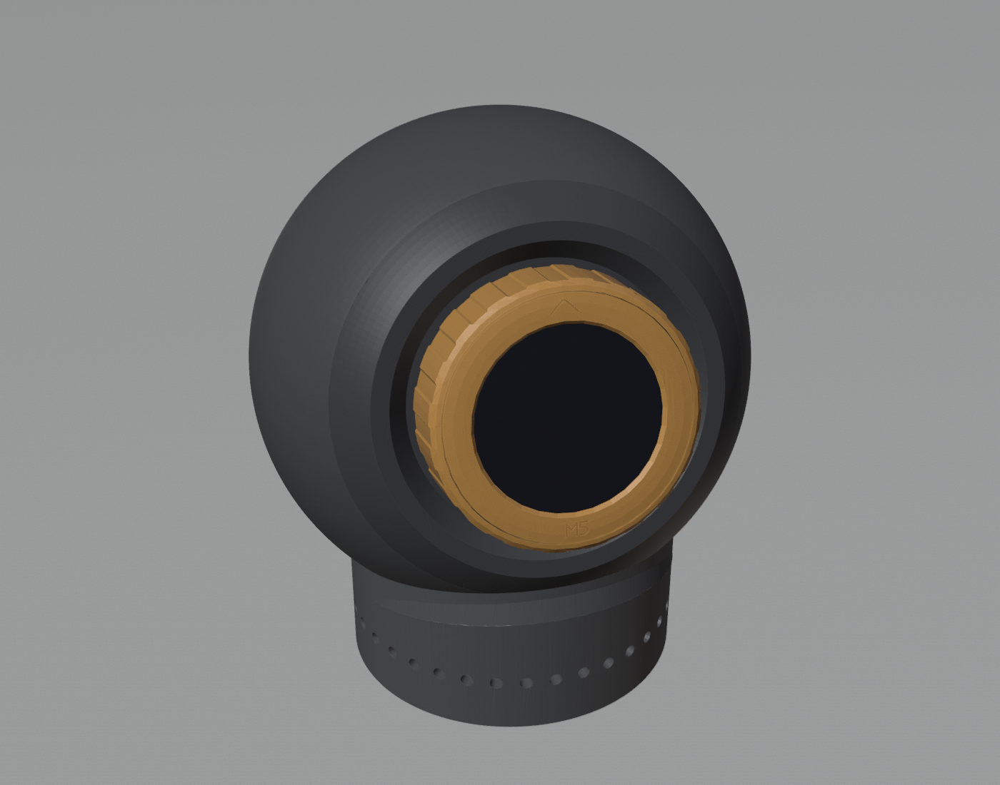
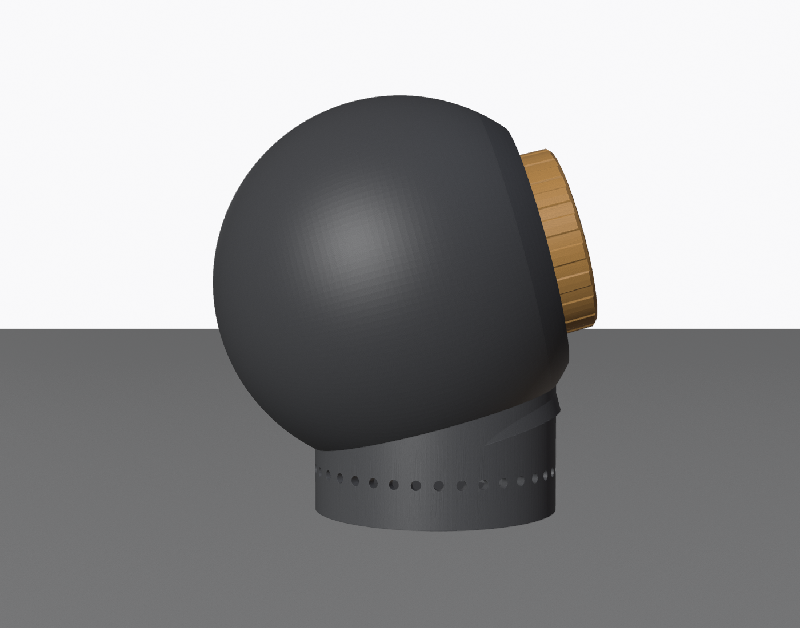
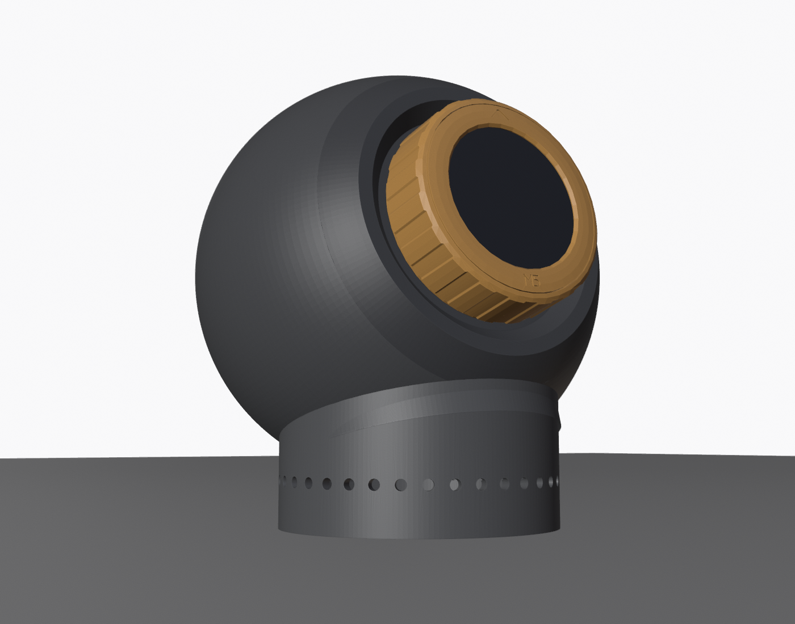
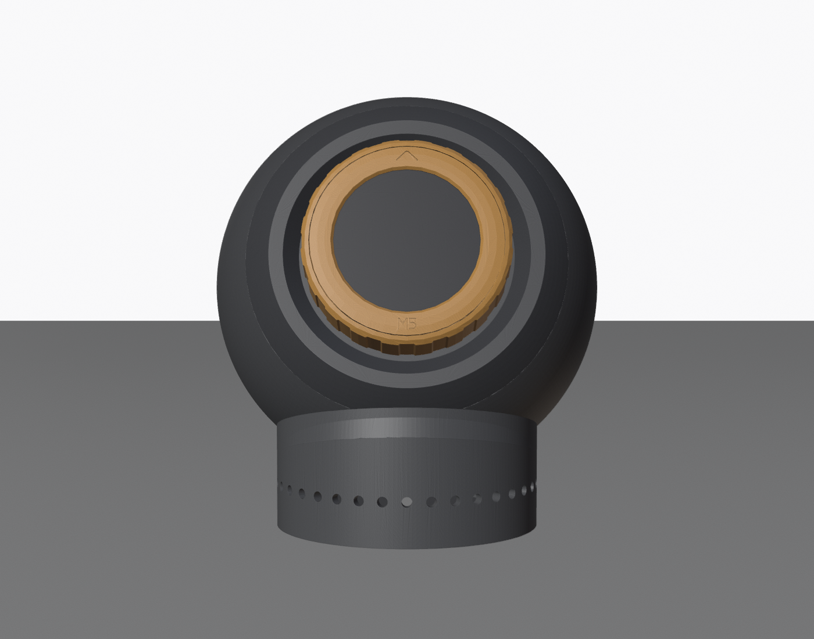
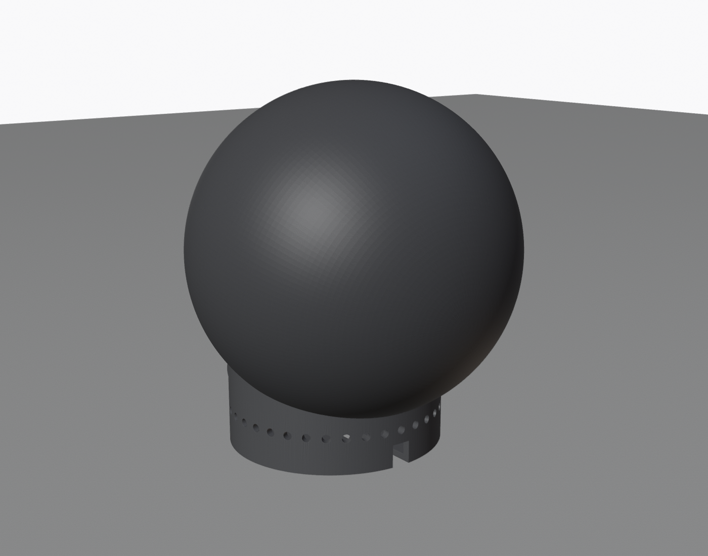
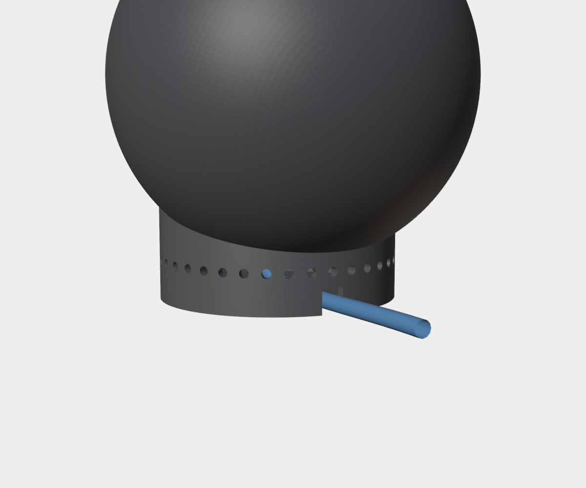
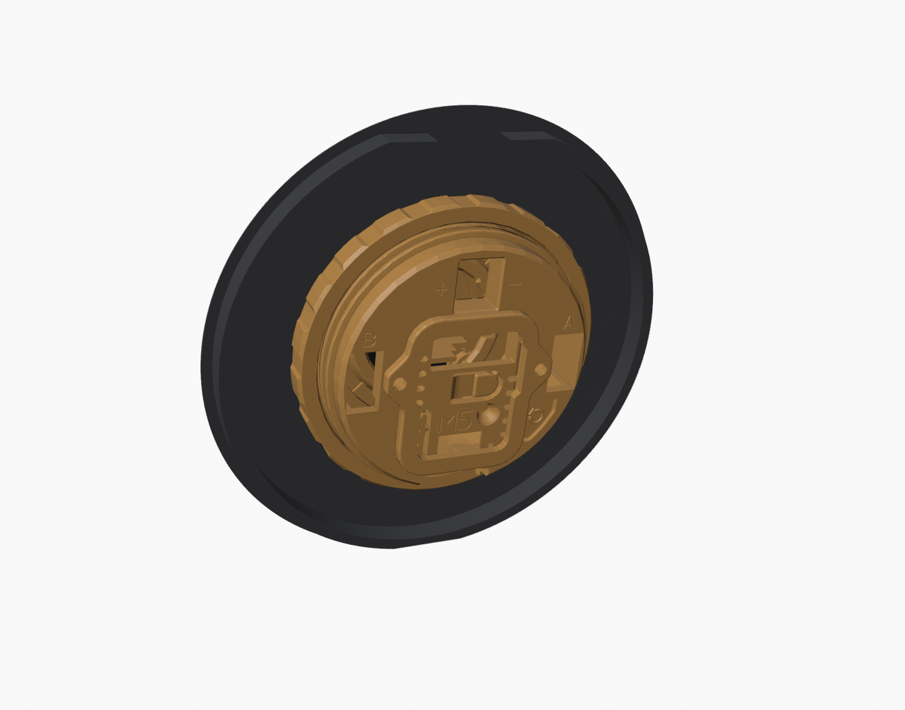
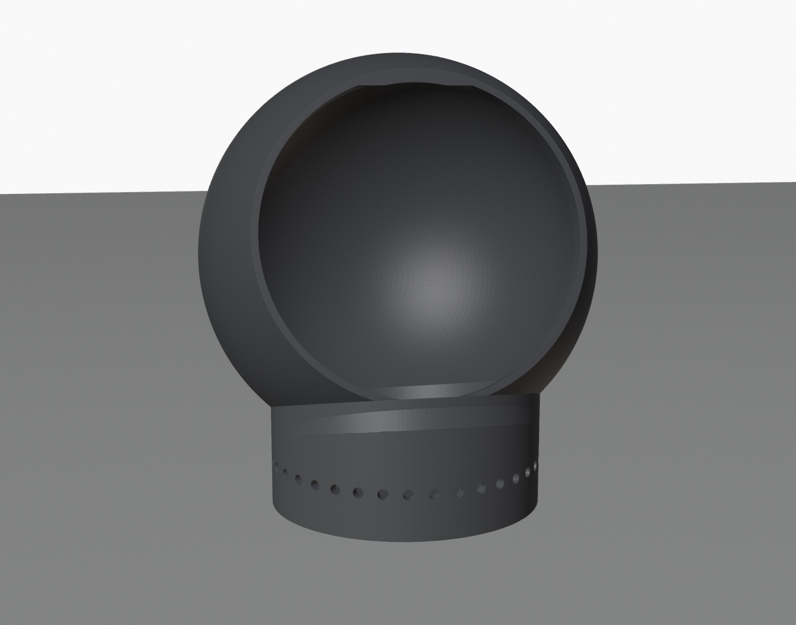
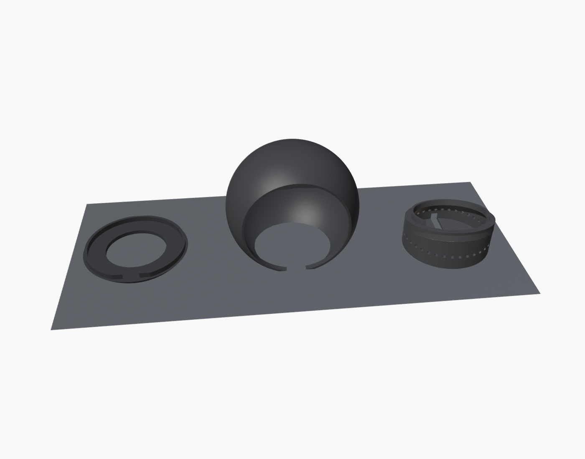
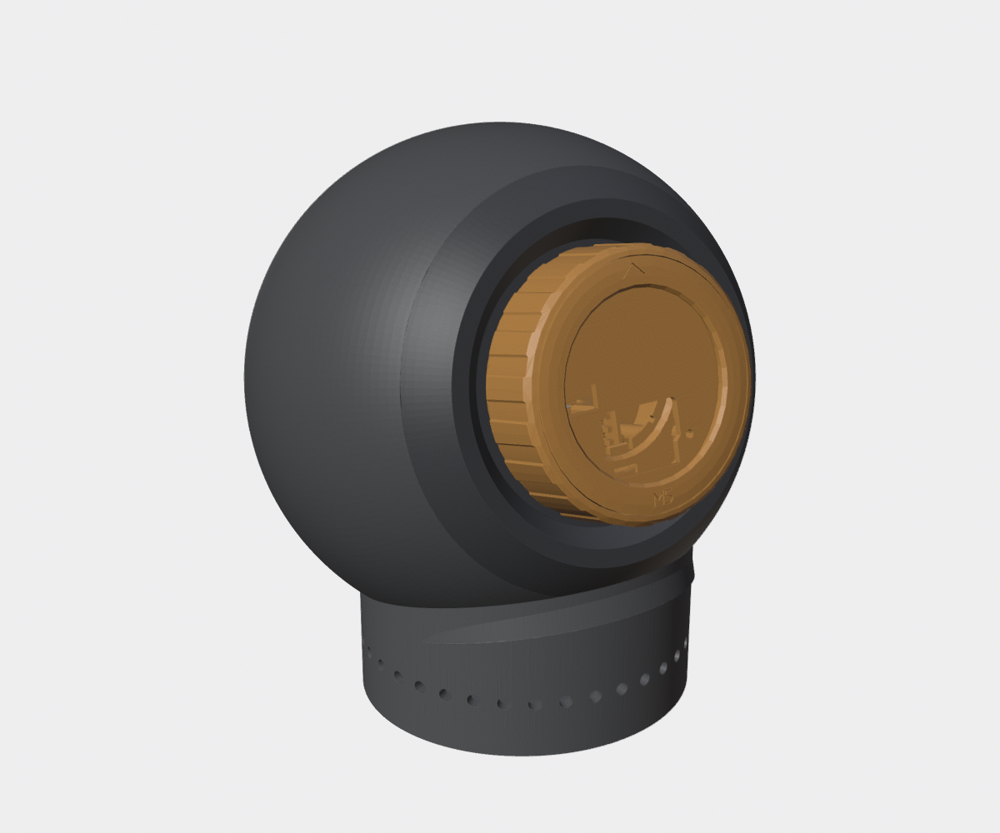

# M5Dial Sphere Stand

[M5Stack Dial](https://docs.m5stack.com/ja/core/Dial) 用の、球体デザインの 3D プリント スタンドです。

M5Dial に付属しているナットで前カバーを挟み込んで固定します（M5Dial はもともと Ø45mm の穴にパネル取付できる構造です）。ネジや接着剤は使いません。画面は **15° 斜め上** を向き、**USB-C は普通のストレートのケーブルで使えます。**

<p align="center">
  
  
</p>

※ プレビューの M5Dial は公式 3D モデルです（色はわかりやすさのためオレンジにしています）。

## ギャラリー

| | |
|---|---|
| <br>斜め下から。台座はくさび形 | <br>正面 |
| <br>背面 | <br>ケーブルは台座の後ろの切り欠きから出す |
| <br>断面。USB-C プラグ（青）がまっすぐ台座まで降りる | <br>分解図 |
| <br>前カバーの裏。M5Dial を付属ナットで挟む。上側は回り止めの D カット | <br>前カバーを外した本体の中 |
| <br>印刷の向き（左から前カバー / 本体 / 台座） | <br>斜め前から |

## 仕様

| 項目 | 値 |
|---|---|
| 外形 | 球 Ø100mm + 台座 Ø67（くさび形、高さ 後ろ 16mm / 前 34mm）。全高 約 111mm |
| 画面の向き | 上向き 15°（球ごと後ろへ傾けている） |
| 固定方法 | M5Dial 付属ナットでパネル（厚さ 3mm）を挟む |
| ケーブル | ストレートの USB-C。台座の後ろの切り欠きから出す |
| パーツ数 | 3（前カバー / 本体 / 台座） |

## パーツと印刷

| ファイル | 内容 | 印刷の向き | サポート |
|---|---|---|---|
| [`stand/m5dial_stand_1_cap.stl`](stand/m5dial_stand_1_cap.stl) | 前カバー（Ø45.4 の取付穴、厚さ 3mm のパネル部） | 正面を下に（出力済みの向き） | 不要 |
| [`stand/m5dial_stand_2_body.stl`](stand/m5dial_stand_2_body.stl) | 球の本体 | 底面を下に（出力済みの向き） | 内側の天井だけ必要（ツリーサポート、ビルドプレートからのみ） |
| [`stand/m5dial_stand_3_base.stl`](stand/m5dial_stand_3_base.stl) | 台座（上面が斜めのくさび形、底板付き、後ろにケーブル切り欠き） | 底面を下に（出力済みの向き） | 不要 |

STL は印刷する向きで出力してあるので、スライサーに読み込んでそのまま印刷できます。PLA、0.2mm ピッチを想定しています。

## 組み立て

1. M5Dial の裏にあるオレンジのナットを外す
2. 前カバーの穴に正面側から M5Dial を差し込み、裏からナットを締める。**USB-C の口が真下に来る向き**にする
3. USB-C ケーブルを挿す。プラグは下向きにまっすぐ、本体の底の穴を通って台座の中まで入る
4. 台座の中でケーブルを後ろへ曲げ、台座の背面の下端にある切り欠き（幅 6mm）に上から落とし込む
5. 前カバーを本体に押し込む。上側の D カットを合わせると回らない
6. 本体を台座に載せる

### おすすめ
- 画面（ボタン）を押すと後ろに倒れやすいので、台座の中に重り（ワッシャーなど 100〜200g）を入れ、底にゴム足を貼る
- USB-C が下向きの取付なので、画面の向きは必要に応じてソフト側の `M5.Display.setRotation()` で調整する

## 寸法の根拠

公式 3D モデル（[M5Stack/M5_Hardware](https://github.com/m5stack/M5_Hardware/tree/master/Products/K130_Dial/Structures) の `Dial.stl`）を実測して設計しました。

- 取付ねじ部: 最大 Ø44.6 → 穴は Ø45.4
- パネルの当たり面（肩）: Ø48。オレンジのナット: Ø51 × 厚さ 5mm。標準の隙間は 1.8mm だが、ねじが後ろへ続くので 3mm のパネルも締められる
- 回転するノブ: Ø49.6。パネル面とのすき間 1.6mm、すり鉢状のくぼみとの横方向のすき間 2.6mm 以上（回しても当たらない）
- USB-C: 本体の側面、肩から 12mm 後ろ

USB-C プラグの干渉チェック結果:

| プラグ | 周囲のすき間（最小） |
|---|---|
| 標準 12.3 × 6.5mm、長さ 32mm | 1.2mm |
| 太め 14 × 7mm | 0.65mm |

プラグの先から台座の底板までは 11mm あり、ここでケーブルを曲げます。プラグの厚みの上限は M5Dial 自身のナットで決まります（約 7.5mm）。

### 傾け方の工夫
USB-C はダイヤルの軸に対して直角に出るので、ダイヤルだけを上に傾けると、下向きのプラグが前にずれて球の内側に当たります。そこで **球ごと後ろへ傾け、台座の上面を斜めにして**います。球の中ではプラグが常に真下を向くので、角度を変えてもプラグのすき間は変わりません。

## カスタマイズ

形状はすべて [`stand/build_stand.py`](stand/build_stand.py)（Blender の Python スクリプト）で生成しています。パラメータを変えて作り直せます。

```bash
# 公式の 3D モデルを取得（干渉チェックとプレビューに使う。初回のみ）
curl -L -o reference/Dial.stl https://raw.githubusercontent.com/m5stack/M5_Hardware/master/Products/K130_Dial/Structures/Dial.stl

# STL とプレビュー画像を生成（Blender 4.x。macOS の例）
/Applications/Blender.app/Contents/MacOS/Blender -b -P stand/build_stand.py
```

実行すると、各パーツのメッシュ検査（非多様体の辺の数）と、M5Dial・USB プラグとの干渉チェックの結果が表示されます。
ギャラリーの画像（5〜12）は `stand/render_views.py` で同じように作り直せます。

| パラメータ | 標準 | 内容 |
|---|---|---|
| `FIT` | 0.15 | はめ合いのクリアランス（片側 mm）。きつければ 0.2〜0.25 に |
| `TILT` | 15 | 画面の上向き角度（°）。20° まで確認済み。25° 以上は台座の後ろが低くなりすぎるので通気穴の位置などの調整が必要 |
| `R` | 50 | 球の半径（mm） |
| `PANEL_T` | 3.0 | M5Dial が挟むパネルの厚さ |
| `BEND_ROOM` | 11 | プラグの先から台座の底板までの余裕。長いプラグなら大きくする（台座が高くなる） |

`TILT` / `BOTTOM_Z` / `BEND_ROOM` は環境変数でも指定できます（例: `TILT=20 Blender -b -P stand/build_stand.py`）。

## 注意

- 試し印刷はまだしていません。はめ合いは `FIT` で調整してください
- M5Dial の 3D モデル（`reference/Dial.stl`）は M5Stack のものです（MIT License）。このリポジトリには含めていません

## ライセンス

[MIT License](LICENSE)。STL・スクリプトとも、改変・再配布・商用利用ができます。
