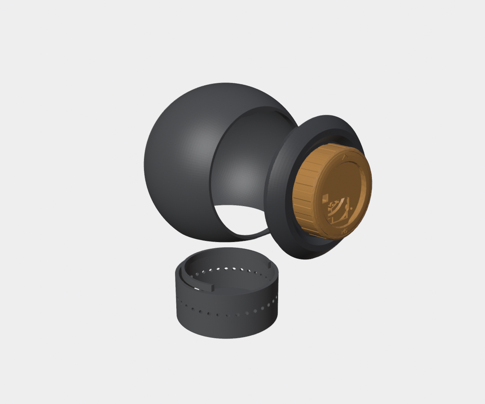
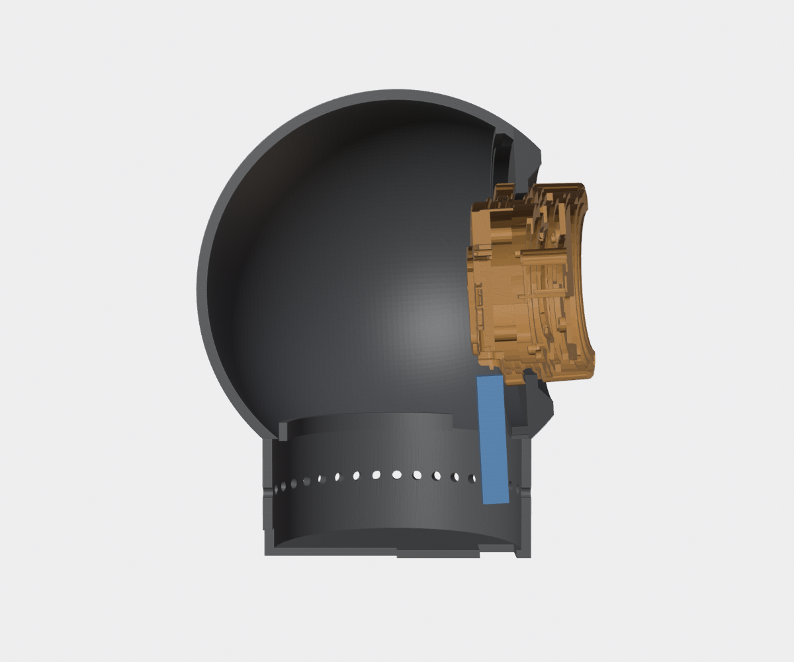

# M5Dial Sphere Stand

[M5Stack Dial](https://docs.m5stack.com/ja/core/Dial) 用の、球体デザインの 3D プリント スタンドです。

M5Dial に付属しているナットで前カバーを挟み込んで固定します（M5Dial はもともと Ø45mm の穴にパネル取付できる構造です）。ネジや接着剤は使いません。**USB-C は普通のストレートのケーブルで使えます。**

<p align="center">
  
  
</p>
<p align="center">
  
  
</p>

※ プレビューの M5Dial は公式 3D モデルです（画面のガラスが省略されているため、中の部品が見えています）。

## 仕様

| 項目 | 値 |
|---|---|
| 外形 | 球 Ø100mm + 台座 Ø67 × 30mm（全高 約 117mm） |
| ダイヤルの向き | 上向き 3° |
| 固定方法 | M5Dial 付属ナットでパネル（厚さ 3mm）を挟む |
| ケーブル | ストレートの USB-C。台座の後ろの切り欠きから出す |
| パーツ数 | 3（前カバー / 本体 / 台座） |

## パーツと印刷

| ファイル | 内容 | 印刷の向き | サポート |
|---|---|---|---|
| [`stand/m5dial_stand_1_cap.stl`](stand/m5dial_stand_1_cap.stl) | 前カバー（Ø45.4 の取付穴、厚さ 3mm のパネル部） | 正面を下に（出力済みの向き） | 不要 |
| [`stand/m5dial_stand_2_body.stl`](stand/m5dial_stand_2_body.stl) | 球の本体 | 底面を下に（出力済みの向き） | 内側の天井だけ必要（ツリーサポート、ビルドプレートからのみ） |
| [`stand/m5dial_stand_3_base.stl`](stand/m5dial_stand_3_base.stl) | 台座（底板付き、後ろにケーブル切り欠き） | そのまま | 不要 |

STL は印刷する向きで出力してあるので、スライサーに読み込んでそのまま印刷できます。PLA、0.2mm ピッチを想定しています。

## 組み立て

1. M5Dial の裏にあるオレンジのナットを外す
2. 前カバーの穴に正面側から M5Dial を差し込み、裏からナットを締める。**USB-C の口が真下に来る向き**にする
3. USB-C ケーブルを挿す。プラグは下向きにまっすぐ、本体の底の穴を通って台座の中まで入る
4. 台座の中でケーブルを後ろへ曲げ、台座の背面の下端にある切り欠き（幅 6mm）に上から落とし込む
5. 前カバーを本体に押し込む。上側の D カットを合わせると回らない
6. 本体を台座に載せる

### おすすめ
- 画面（ボタン）を押すと後ろに倒れやすいので、台座の中に重り（ワッシャーなど 100〜200g）を入れ、底にゴム足を貼る
- USB-C が下向きの取付なので、画面の向きは必要に応じてソフト側の `M5.Display.setRotation()` で調整する

## 寸法の根拠

公式 3D モデル（[M5Stack/M5_Hardware](https://github.com/m5stack/M5_Hardware/tree/master/Products/K130_Dial/Structures) の `Dial.stl`）を実測して設計しました。

- 取付ねじ部: 最大 Ø44.6 → 穴は Ø45.4
- パネルの当たり面（肩）: Ø48。オレンジのナット: Ø51 × 厚さ 5mm。標準の隙間は 1.8mm だが、ねじが後ろへ続くので 3mm のパネルも締められる
- 回転するノブ: Ø49.6。パネル面とのすき間 1.6mm、すり鉢状のくぼみとの横方向のすき間 2.6mm 以上（回しても当たらない）
- USB-C: 本体の側面、肩から 12mm 後ろ

USB-C プラグの干渉チェック結果:

| プラグ | 周囲のすき間（最小） |
|---|---|
| 標準 12.3 × 6.5mm、長さ 32mm | 1.35mm |
| 太め 14 × 7mm | 1.1mm |

プラグの先から台座の底板までは 11.6mm あり、ここでケーブルを曲げます。プラグの厚みの上限は M5Dial 自身のナットで決まります（約 7.5mm）。

## カスタマイズ

形状はすべて [`stand/build_stand.py`](stand/build_stand.py)（Blender の Python スクリプト）で生成しています。パラメータを変えて作り直せます。

```bash
# 公式の 3D モデルを取得（干渉チェックとプレビューに使う。初回のみ）
curl -L -o reference/Dial.stl https://raw.githubusercontent.com/m5stack/M5_Hardware/master/Products/K130_Dial/Structures/Dial.stl

# STL とプレビュー画像を生成（Blender 4.x。macOS の例）
/Applications/Blender.app/Contents/MacOS/Blender -b -P stand/build_stand.py
```

実行すると、各パーツのメッシュ検査（非多様体の辺の数）と、M5Dial・USB プラグとの干渉チェックの結果が表示されます。

| パラメータ | 標準 | 内容 |
|---|---|---|
| `FIT` | 0.15 | はめ合いのクリアランス（片側 mm）。きつければ 0.2〜0.25 に |
| `TILT` | 3 | ダイヤルの上向き角度（°）。ストレートのプラグを通すには 3° 程度が上限 |
| `R` | 50 | 球の半径（mm） |
| `PANEL_T` | 3.0 | M5Dial が挟むパネルの厚さ |
| `BASE_H` | 30 | 台座の高さ。プラグの先が底に当たるなら大きくする |

`TILT` / `BOTTOM_Z` / `BASE_H` は環境変数でも指定できます（例: `TILT=0 Blender -b -P stand/build_stand.py`）。

## 注意

- 試し印刷はまだしていません。はめ合いは `FIT` で調整してください
- M5Dial の 3D モデル（`reference/Dial.stl`）は M5Stack のものです（MIT License）。このリポジトリには含めていません
